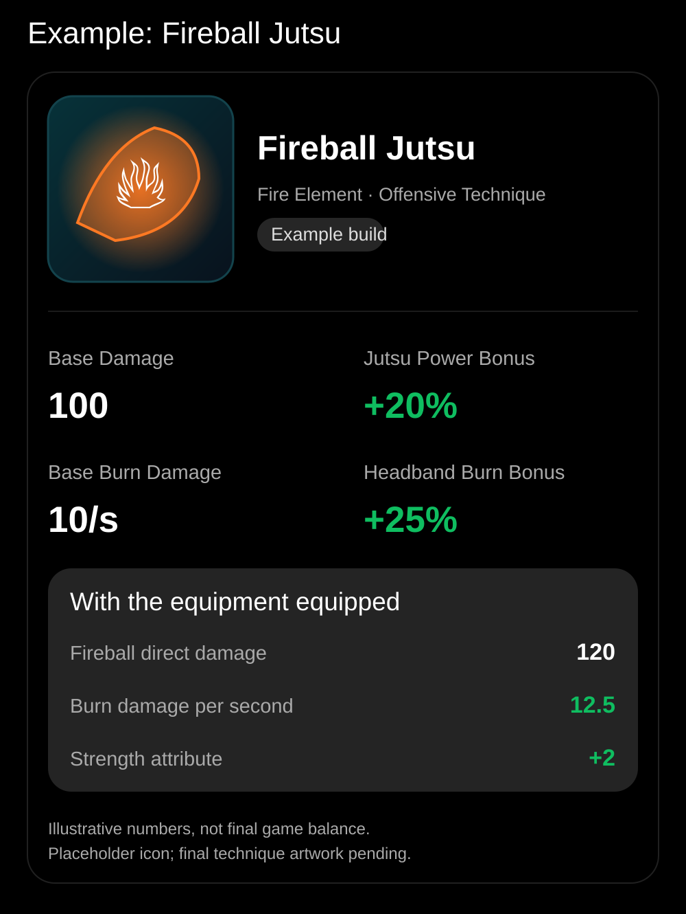

[Open full-size visual card](./fireball.svg)

---

# Fireball Jutsu — Build Illustration

> **Fire · Direct hit + Burn**
>
> **BASE** → 100 direct; 10 burn/sec
>
> **EQUIPPED MODIFIERS** → Jutsu Power +20%; Burn Damage +25%; Strength +2
>
> **RESULT** → **120 direct; 12.5 burn/sec; Strength +2**

| Layer | Effect |
|---|---|
| Base technique | 100 direct; 10 burn/sec |
| Character-wide Jutsu Power | +20% offensive jutsu damage where applicable |
| Targeted equipment | Jutsu Power +20%; Burn Damage +25%; Strength +2 |
| Effective output | **120 direct; 12.5 burn/sec; Strength +2** |
| Jutsu mastery | Technique-specific: combat, trainer, or hybrid; not yet assigned |

**Calculation note:** Direct elemental damage examples apply Jutsu Power then elemental damage multiplicatively; e.g. Lightning: 100 × 1.20 × 1.10 = 132. Burn ticks use only Burn Damage in the Fireball example. Defensive jutsu are not assigned offensive damage multipliers. These are illustrative formulas, not locked balancing.

**Design status:** Example only; not confirmed as playable roster entry.
