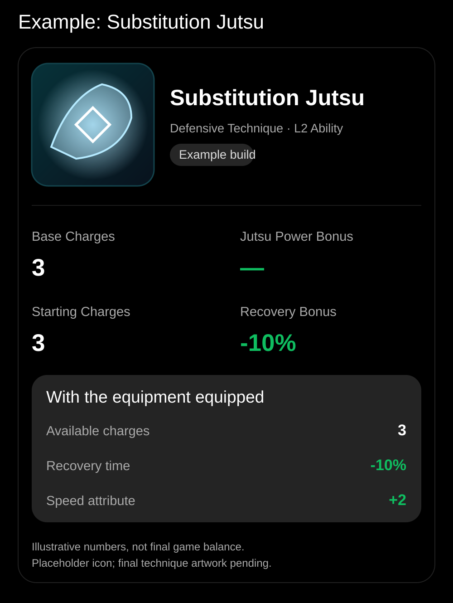

[Open full-size visual card](./substitution.svg)

---

# Substitution Jutsu — Build Illustration

> **Defensive · Timed defensive escape**
>
> **BASE** → 3 starting charges; no direct damage
>
> **EQUIPPED MODIFIERS** → Substitution Recovery -10%; Speed +2
>
> **RESULT** → **Faster recovery; Speed +2; direct damage unchanged**

| Layer | Effect |
|---|---|
| Base technique | 3 starting charges; no direct damage |
| Character-wide Jutsu Power | +20% offensive jutsu damage where applicable |
| Targeted equipment | Substitution Recovery -10%; Speed +2 |
| Effective output | **Faster recovery; Speed +2; direct damage unchanged** |
| Jutsu mastery | Technique-specific: combat, trainer, or hybrid; not yet assigned |

**Calculation note:** Direct elemental damage examples apply Jutsu Power then elemental damage multiplicatively; e.g. Lightning: 100 × 1.20 × 1.10 = 132. Burn ticks use only Burn Damage in the Fireball example. Defensive jutsu are not assigned offensive damage multipliers. These are illustrative formulas, not locked balancing.

**Design status:** L2 dedicated defensive technique is confirmed. Modifier is a proposal, not a locked item.
