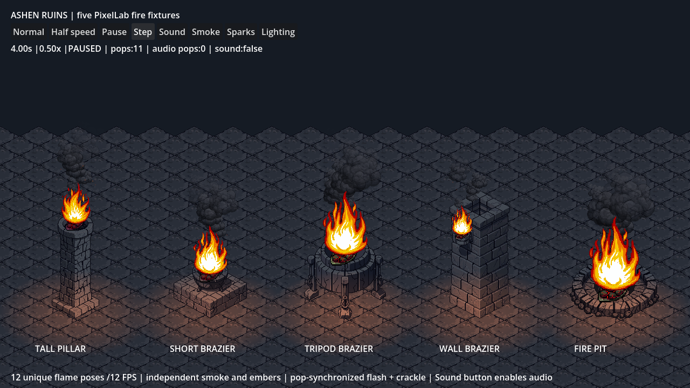

# Ashen Ruins fire pack

[Half-speed preview](half-speed.gif) | [Normal-speed preview](normal.gif) | [Flame contact sheet](flame-contact.png) | [Fixture contact sheet](fixture-contact.png)

Five PixelLab fixtures: tall pillar, short brazier, tripod brazier, wall brazier and ground fire pit. The stone colors come from the existing floor tiles. The flame layer has 12 unique registered poses at 12 FPS. Smoke, embers, glowing coals, light fluctuations and crackle pops run separately so the full effect does not repeat as a single synchronized loop.

In the live game, open World Builder and select **Ashen fire**. Each fixture supports selection, movement, deletion and layout saving. No objects are automatically added to an existing player layout. The approved volcanic trees have their own **Volcanic trees** filter.

The GIFs contain 192 actual Godot Web captures: 8 seconds normal, 16 seconds half speed. They are silent. In-game positional audio uses an original four-second ambient bed and three crackle clips; a pop triggers its sound, flash and spark burst together. The standalone Godot review scene has Sound, Smoke, Sparks and Lighting toggles plus Pause, Step and playback speeds.

Art metadata: [ashen-fire.art.json](../../../assets/environment/ashen_fire/ashen-fire.art.json). Runtime: [ashen_fire_prop.gd](../../../scripts/environment/ashen_fire_prop.gd). Validation JSON, source job provenance and the Codex report accompany the assets.
