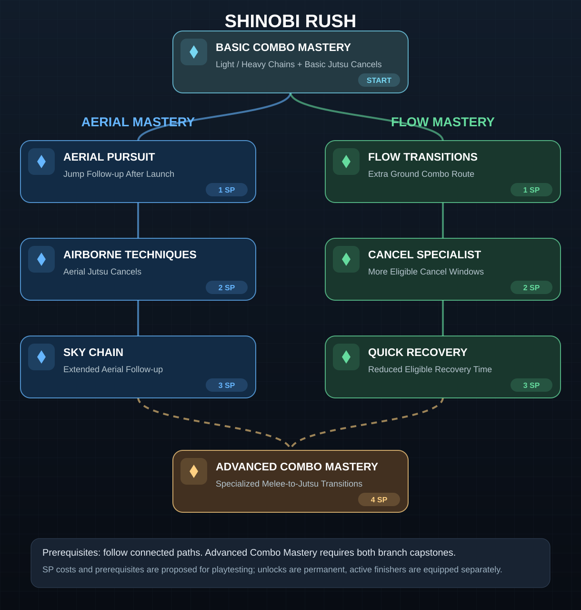

# Combat Skill Tree — Visual Concept V1

[Open the full-size SVG](./combat-skill-tree.svg)

## Status
**Approved direction:** Combat Skill Tree unlocks and upgrades combat capabilities, while **Character Equipment → Combat Loadout** equips two finishers (Light and Heavy). The starting kit includes basic eligible melee-to-jutsu cancels.

**Provisional design:** Specific skill node names, skill-point costs, branch order, and requirement for both capstones to unlock Advanced Combo Mastery are **concept proposals**, not yet locked or balanced.

## Proposed paths
- **Aerial Mastery:** Aerial Pursuit (1 SP) → Airborne Techniques (2 SP) → Sky Chain (3 SP).
- **Flow Mastery:** Flow Transitions (1 SP) → Cancel Specialist (2 SP) → Quick Recovery (3 SP).
- **Advanced Combo Mastery:** Both capstones → Specialized Melee-to-Jutsu Transitions (4 SP).

## Implementation guardrails
- Never force aerial launches on all combos; launch behavior depends on equipped finishers.
- Aerial jutsu cancels require techniques that explicitly support aerial use.
- Maintain Chakra cost, cooldowns, juggle limits, and move-specific cancel/recovery windows.
- Keep finisher slots at exactly two; skill tree nodes do not add extra equipped slots.
- Costs, unlock levels, prerequisites, and precise frame windows must be validated in playtests.

This SVG is a standalone GitHub-previewable visual asset intended for the future HTML GDD.

## Expandable multi-category progression — locked
- Players may invest in **both Aerial Mastery and Flow Mastery** and eventually unlock all skills in both branches. No permanent specialization lockout.
- Combat progression is an **extensible skill-tree hub**, not a permanently fixed two-branch tree. Additional branches and categories can be introduced as new mechanics are designed.
- Keep branches modular with stable skill IDs and explicit prerequisites so new categories can be added without redesigning existing unlocks.
- **Recommended interface direction (not yet locked):** zoom/pan canvas and collapsible skill categories for larger trees.
- Existing node costs, branch topology, and capstone prerequisites remain **provisional**, not final balancing.

## Movement and defensive design exploration (pending input approval)
- Existing locked controls remain: left stick eight-direction movement; R1 sprint; Circle directional dodge; Cross jump / assisted aerial pursuit when eligible; L2 substitution (three independently recharging charges); R3 optional hard lock-on.
- **Proposed:** dodge is available from the start with brief invulnerability and timing-based counter opportunities; tune distance, cooldown/recovery and invulnerability in playtests.
- **Proposed, NOT LOCKED:** guard/perfect guard with damage reduction, a narrow timing window, and stagger/counter reward. **No guard button assigned yet**; do not conflict with L1 healing, L2 substitution, R1 sprint, R2 jutsu modifier, or existing face-button attacks.
- **Proposed:** defensive counter skills as future branches in the expandable Combat Skill Tree, preserving freedom to invest in all branches.
- Substitution is the limited emergency escape; guard/dodge should not obsolete its three independently recharging charges.
- Needs explicit approval: whether guard/parry should exist and what control or contextual activation it should use.
