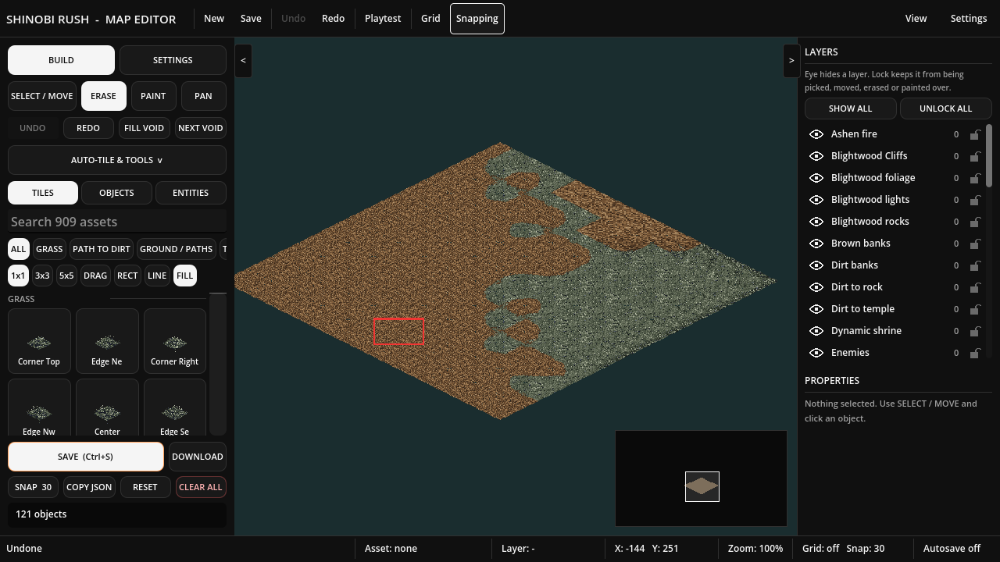

# Smart Terrain Brush proof

Local affected-system acceptance: **84 integration checks (35 Smart Brush + 49 publisher/shared-map), 13 Smart Brush browser checks, 27 existing Auto Blend browser checks; zero browser errors**. Fresh Godot 4.7.2 Web export and 448-script /30-scene /2-resource validation passed. Now merged and live: PR #265, build 4f84ff39c9bdae55b7c9c5ceaa99e24fbbf750d6.

- browser-result.json: actual Chromium menu, pointer, keyboard history, connected fill, JSON reload and saved-world preservation.
- auto-blend-result.json: all twenty material pair/triple layouts, shared corners, movement, history and black editor.
- integration-native.log: combined approval/published-revision save compatibility after merging #263.
- focused-native.log: metadata, diamond features, pixel self matches, approvals/rejection/history, paint/fill/erase, actual file save/reload and locks.
- resources.log, export-check.log, project-validation.json: successful local build/resource checks.

The local export is a dirty build labeled with base 5a689112; it is not a deployed-head claim. Failed intermediate harness attempts remain outside the repository and are explained in the [job report](../../../orders/Codex/reports/2026-10-29-smart-terrain-brush-report.md). [Usage and limits](../../editor/smart-terrain-family-suggestions.md).

## Canonical live proof
Main [deployment workflow](https://github.com/kiotdstudios/shinobi-rush/actions/runs/40975744375) passed including post-deploy smoke. **5,252 native assertions and 42 exact-build live Chromium checks passed, zero browser errors.** [Deployment summary](live/deployment.json), [Smart Brush result](live/smart-result.json), [terrain blend result](live/auto-blend-result.json). Exact UTC completion times are embedded in results.

