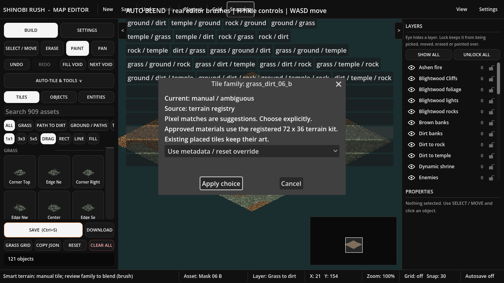

# Smart Terrain Brush proof

Local affected-system acceptance: **35 native checks, 13 Smart Brush browser checks, 27 existing Auto Blend browser checks; zero browser errors**. Fresh Godot 4.7.2 Web export and 448-script /30-scene /2-resource validation passed. NOT LIVE until reviewed integration and canonical exact-build verification.

- browser-result.json: actual Chromium menu, pointer, keyboard history, connected fill, JSON reload and saved-world preservation.
- auto-blend-result.json: all twenty material pair/triple layouts, shared corners, movement, history and black editor.
- focused-native.log: metadata, diamond features, pixel self matches, approvals/rejection/history, paint/fill/erase, actual file save/reload and locks.
- resources.log, export-check.log, project-validation.json: successful local build/resource checks.

The local export is a dirty build labeled with base 5a689112; it is not a deployed-head claim. Failed intermediate harness attempts remain outside the repository and are explained in the [job report](../../../orders/Codex/reports/2026-10-29-smart-terrain-brush-report.md). [Usage and limits](../../editor/smart-terrain-family-suggestions.md).
