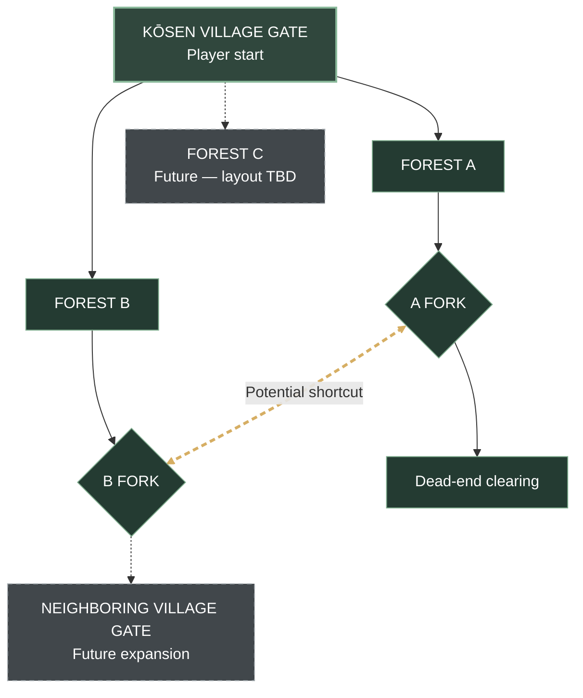

# Kōsen Forest — Full World Expansion Map

**Status:** Long-term concept · The MVP-only diagram is at [MVP_WORLD_MAP.md](MVP_WORLD_MAP.md).

### Confirmed topology
- Three forest routes ultimately lead away from Kōsen Gate.
- Forest A forks; one branch terminates in a dead end.
- Forest B forks; one branch leads toward the neighboring village gate in the future.
- **Potential shortcut: Forest A fork ↔ Forest B fork. Never route this shortcut to the Kōsen Gate.**
- Forest C's downstream path is still unspecified.
- The neighboring village gate and Forest C are **not** part of the MVP.
- Diagrams represent route connections, not physical scale.

### Revisions
- v0.2: Corrected shortcut to join the two forks; separated full-world and MVP diagrams.
