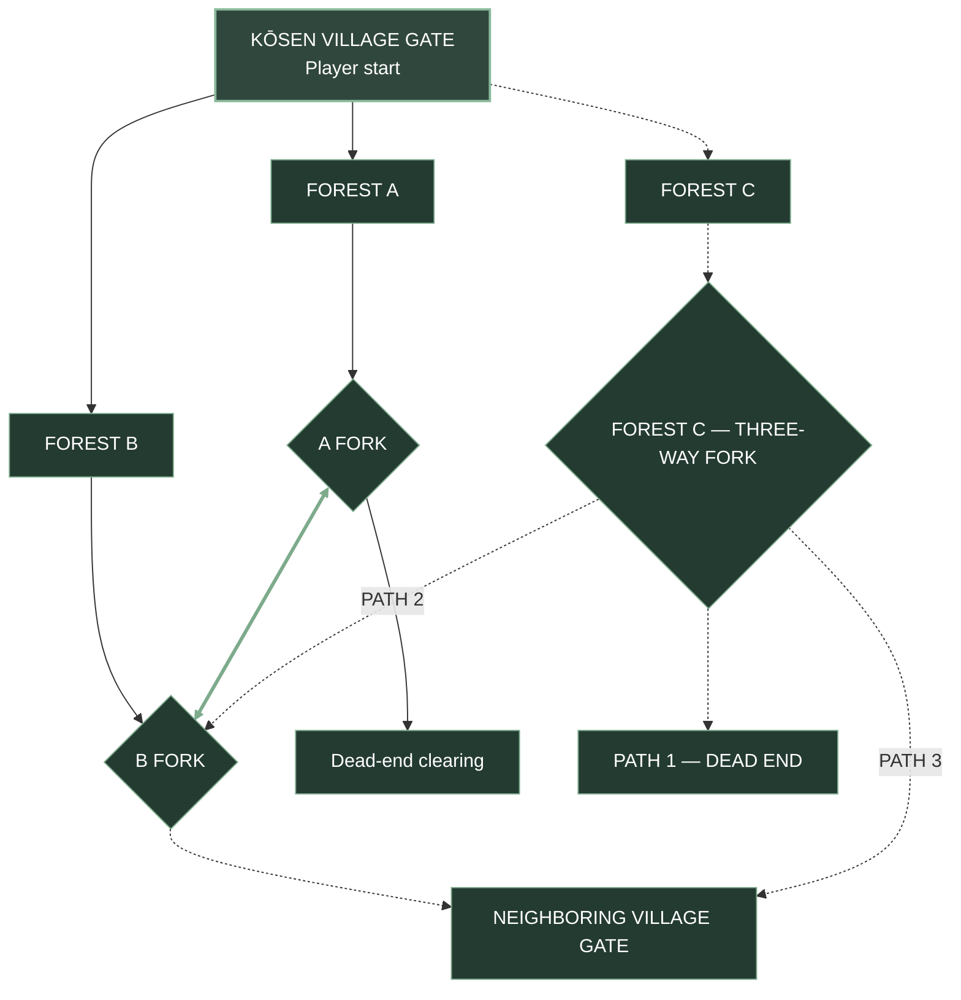

# Kōsen Forest — Full World Expansion Map

**Status:** Long-term concept · The MVP-only diagram is at [MVP_WORLD_MAP.md](MVP_WORLD_MAP.md).

### Confirmed topology
- Three forest routes ultimately lead away from Kōsen Gate.
- Forest A forks; one branch terminates in a dead end.
- Forest B forks; one branch leads toward the neighboring village gate in the future.
- **Confirmed path: Forest A fork ↔ Forest B fork.** This is a real connection, not a potential shortcut.
- Forest C splits into **three paths**: **Path 1 is a dead end**, **Path 2 connects to Forest B fork**, and **Path 3 goes straight to the neighboring village gate**.
- Forest B's previously planned connection to the neighboring village gate remains shown; Forest C Path 2 also connects to B fork and Path 3 reaches the neighboring village gate directly.
- The neighboring village gate and Forest C are **not** part of the MVP.
- Diagrams represent route connections, not physical scale.

### Revisions
- v0.8: Removed the redundant "Confirmed forest path" label from the A–B connector; retained the solid line.
- v0.7: Forest C Path 1 confirmed dead end; removed explanatory subtitles and shortened Path 2/3 link labels for a cleaner diagram.
- v0.6: Confirmed A fork to B fork as a real forest path.
- v0.5: All forest and destination nodes share the same green styling; dashed links still identify future routes.
- v0.4: Forest C Path 2 connects to Forest B fork; Path 3 goes directly to the neighboring village gate; Path 1 remains TBD.
- v0.3: Added Forest C three-way fork with one route to the neighboring village gate and two future destinations.
- v0.2: Corrected shortcut to join the two forks; separated full-world and MVP diagrams.
