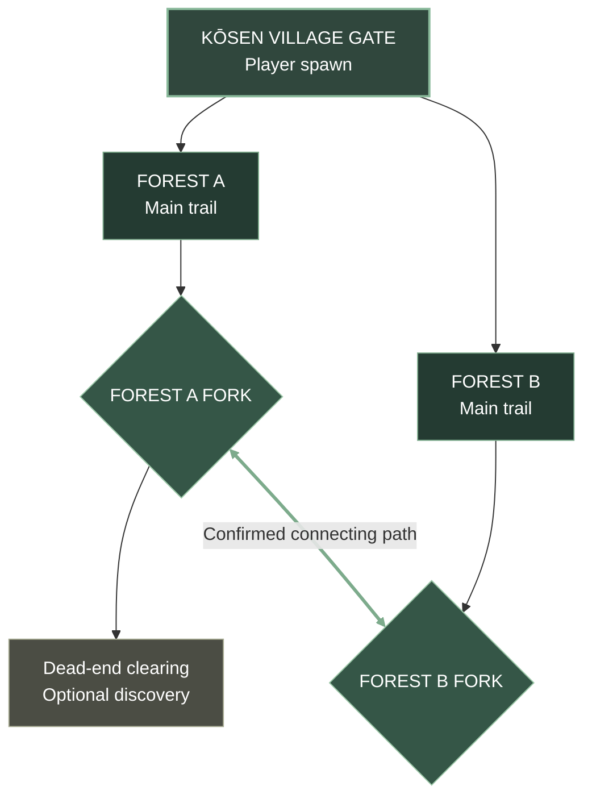

# Kōsen Forest — MVP World Map

**Status:** Approved starting layout · **Scope:** Kōsen Gate + Forest A + Forest B

## MVP route diagram

**Read order:** Spawn at Kōsen Gate → choose Forest A or Forest B → each trail leads to its own fork → Forest A's fork has a dead-end branch → the **confirmed path connects Forest A's fork directly to Forest B's fork**. It does **not** connect back to the gate.

### Locked exploration rule
- **Both Forest A and Forest B are open immediately** when the player leaves Kōsen Village Gate; no quest gate or artificial lock.
- **Forest A is the lower-difficulty route**, introducing basic bandits, combat practice, and exploration.
- **Forest B is the higher-difficulty route**, including tougher encounters and heavy bandits. Players may enter it first at their own risk.
- The **Forest A fork ↔ Forest B fork** connection is a real traversable path, allowing travel between both forests without returning to the gate.
- Exact enemy placements, rewards, and boss location remain TBD.

### MVP design notes
- One contiguous forest biome, two playable routes; branching exploration and backtracking.
- Basic bandit, heavy bandit, and one boss. Enemy placements and boss location remain TBD.
- **Confirmed traversable path** connects Forest A fork and Forest B fork. No unlock condition is assumed.
- Forest C and the neighboring village gate are excluded from the MVP.
- This diagram is a **topology**, not a geographically scaled level map. Exact trail geometry and distances are TBD.

## Future revisions
Add checkpoint positions, encounters, landmark names, rewards, boss arena, and unlock conditions as they are decided. Keep this diagram simple enough to read on mobile.

## Progression discovery and route tutorials — design direction
- **Jutsu scrolls** are discoverable throughout the world. Collecting a scroll adds **unlearned knowledge** to inventory; it does not instantly unlock a technique.
- Players take discovered scrolls to dedicated learning locations (previously called shrines; **final in-world name TBD**) to learn the corresponding jutsu and add it to their usable technique inventory.
- Learned techniques can be assigned to the existing four R2 technique slots. Exact costs and learning interaction TBD.
- **Awakenings** are taught by specialist NPCs, not granted by scrolls alone. Training requires a specified number of encounters/challenges and specified crafting items; requirements vary by awakening and remain TBD.
- Eight Gates and Sage Mode are mechanical inspirations; use original terminology, lore, and visual designs in Shinobi Rush.
- **Forest A** introduces scroll discovery, unlearned inventory, and learning locations; its dead-end branch is a candidate for the first scroll.
- **Forest B** introduces specialist NPCs, awakening prerequisites, and crafting materials.
- **Both forests stay open immediately.** Route tutorials are contextual and optional; entering Forest B first must not break onboarding or progression.
- Suggested name **Echo Sanctums** is a proposal only, **not locked**.
