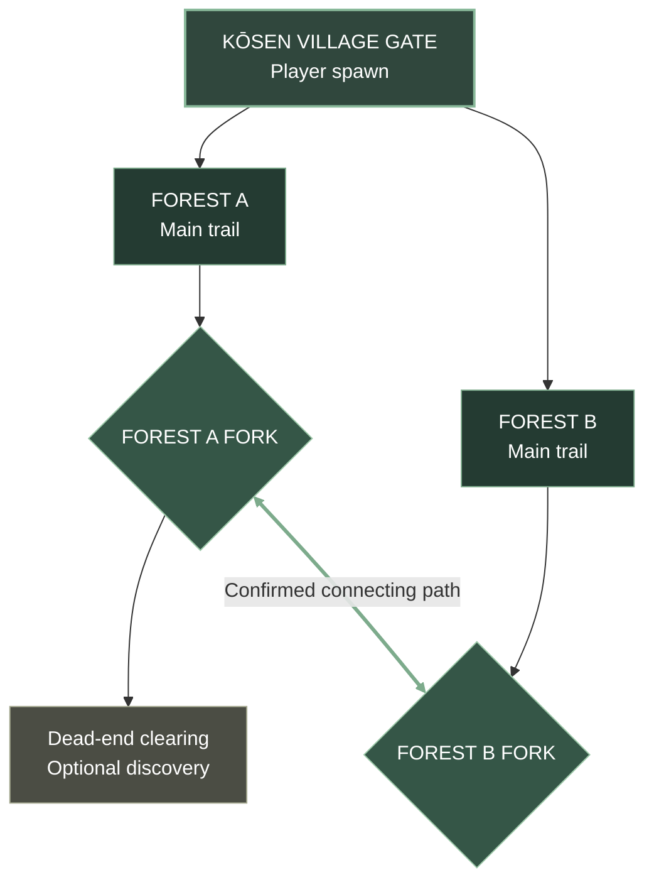

# Kōsen Forest — MVP World Map

**Status:** Approved starting layout · **Scope:** Kōsen Gate + Forest A + Forest B

## MVP route diagram

**Read order:** Spawn at Kōsen Gate → choose Forest A or Forest B → each trail leads to its own fork → Forest A's fork has a dead-end branch → the **confirmed path connects Forest A's fork directly to Forest B's fork**. It does **not** connect back to the gate.

### Locked exploration rule
- **Both Forest A and Forest B are open immediately** when the player leaves Kōsen Village Gate; no quest gate or artificial lock.
- **Forest A is the lower-difficulty route**, introducing basic bandits, combat practice, and exploration.
- **Forest B is the higher-difficulty route**, including tougher encounters and heavy bandits. Players may enter it first at their own risk.
- The **Forest A fork ↔ Forest B fork** connection is a real traversable path, allowing travel between both forests without returning to the gate.
- Exact enemy placements, rewards, and boss location remain TBD.

### MVP design notes
- One contiguous forest biome, two playable routes; branching exploration and backtracking.
- Basic bandit, heavy bandit, and one boss. Enemy placements and boss location remain TBD.
- **Confirmed traversable path** connects Forest A fork and Forest B fork. No unlock condition is assumed.
- Forest C and the neighboring village gate are excluded from the MVP.
- This diagram is a **topology**, not a geographically scaled level map. Exact trail geometry and distances are TBD.

## Future revisions
Add checkpoint positions, encounters, landmark names, rewards, boss arena, and unlock conditions as they are decided. Keep this diagram simple enough to read on mobile.

## Progression discovery and route tutorials — design direction
- **Jutsu scrolls** are discoverable throughout the world. Collecting a scroll adds **unlearned knowledge** to inventory; it does not instantly unlock a technique.
- Players bring the required scrolls and/or crafting materials to a **trainer** at **Training Grounds** (universal gameplay term; village-specific local names and architecture), exchange the resources, and learn the corresponding jutsu.
- Learned techniques can be assigned to the existing four R2 technique slots. Exact costs and learning interaction TBD.
- **Awakenings** are taught by specialist NPCs, not granted by scrolls alone. Training requires a specified number of encounters/challenges and specified crafting items; requirements vary by awakening and remain TBD.
- Eight Gates and Sage Mode are mechanical inspirations; use original terminology, lore, and visual designs in Shinobi Rush.
- **Forest A** introduces scroll/material discovery, inventory, and trainer-based learning; its dead-end branch is a candidate for the first scroll.
- **Forest B** introduces specialist NPCs, awakening prerequisites, and crafting materials.
- **Both forests stay open immediately.** Route tutorials are contextual and optional; entering Forest B first must not break onboarding or progression.
- **Locked naming:** Training Grounds is the universal term. **Kōsen Village uses Mastery Chambers** as its local training-ground identity. **Inner Mastery Court** is a proposed name for another village's training grounds (village assignment TBD). Each village can have distinctive architecture while sharing the same scroll-learning function.

## Trainer-based jutsu learning — current locked design
- **No jutsu-learning minigames or puzzles.** This supersedes the earlier Mastery Chamber minigame concept.
- Every learnable jutsu requires **both technique-specific scroll fragments AND crafting materials**. Neither resource alone is sufficient.
- Visit a **trainer** at a Training Ground (Kōsen's local training facility: **Mastery Chambers**) and exchange the required scroll fragments and crafting materials to learn the technique.
- Learned jutsu enters the usable skill inventory and can be assigned to the four R2 technique slots.
- **Awakenings remain distinct:** NPC specialists teach them after required encounters/training milestones and crafting-item prerequisites.
- **MVP:** one trainer, one obtainable jutsu, resource requirement, exchange interaction, and learned-skill equip flow.
- Exact fragment counts, material types, costs, drop locations, and exchange quantities are TBD; exchanges consume the required resources.

## Locked jutsu resource rule
- Jutsu learning requires **scroll fragments + crafting materials together** at a trainer in the village-specific Training Grounds (Kōsen: Mastery Chambers).
- Fragments are **technique-specific**, with requirements and crafting materials varying by jutsu.
- Once the trainer exchange is completed, the jutsu is learned and can be equipped.
- Sample costs mentioned during planning are illustrative only and are **not locked balance values**.

## Resource acquisition and trade — locked direction
Every learnable jutsu requires **technique-specific scroll fragments plus crafting materials**, exchanged at a trainer in the Training Grounds (Kōsen: Mastery Chambers).

**Approved resource sources:**
1. Enemy loot drops (including bandits, elites, bosses).
2. Hidden chests and exploration discoveries.
3. Quest rewards.
4. Random in-world loot drops.
5. Player-to-player trading of eligible resources.
6. Village markets and NPC merchants.
7. Traveling specialist NPC merchants with distinctive inventories.

**Implementation scope:** For the single-player MVP, prioritize enemy drops, chests, quest rewards, random world loot, and a basic NPC merchant. Player trading and a broader market economy are future systems; do not imply that multiplayer trading ships in the MVP. Exact drop rates, loot tables, item tradability, market prices, merchant rotations, and rarity balance remain TBD.

**Forest onboarding:** Introduce multiple acquisition sources through contextual discoveries on Forest A and Forest B without forcing a linear tutorial or closing either path.

## Supply bag capacity and upgrades — locked initial rules
- The player starts with **12 total shared inventory slots** for scroll fragments and crafting materials combined (not 12 each).
- Increasing bag capacity requires gathering **bag-upgrade materials** and performing an upgrade. Upgrade service/location and material recipes TBD.
- Inventory capacity is a meaningful exploration and resource-management constraint.
- **Locked stacking:** identical scroll fragments and crafting materials stack up to **99 units per slot**. The 100th unit begins a new stack and consumes another shared bag slot.
- **Locked jutsu fragment costs:** basic jutsu require **10 technique-specific scroll fragments**; rarer jutsu require **20 or more** fragments, scaled by rarity. Every jutsu additionally requires crafting materials and trainer exchange.
- **Not yet locked:** exact expansion increments and maximum bag capacity; whether quest items use separate slots; handling pickups when full; specific rare-tier costs and material recipes.
- **Suggested only (not locked):** 12 → 16 → 20 → 24 slots; identical items stack up to 99 units per slot.

## Inventory stacking and jutsu fragment thresholds — confirmed
- Shared bag begins at **12 slots** for fragments and materials.
- Each identical item stack holds **99**; additional units split into new stacks and consume additional slots.
- **Basic jutsu: 10 fragments** of that specific technique, plus crafting materials, exchanged at a trainer.
- **Rare jutsu: 20+ fragments** of that specific technique, plus crafting materials, exchanged at a trainer. Precise higher-tier costs TBD.
