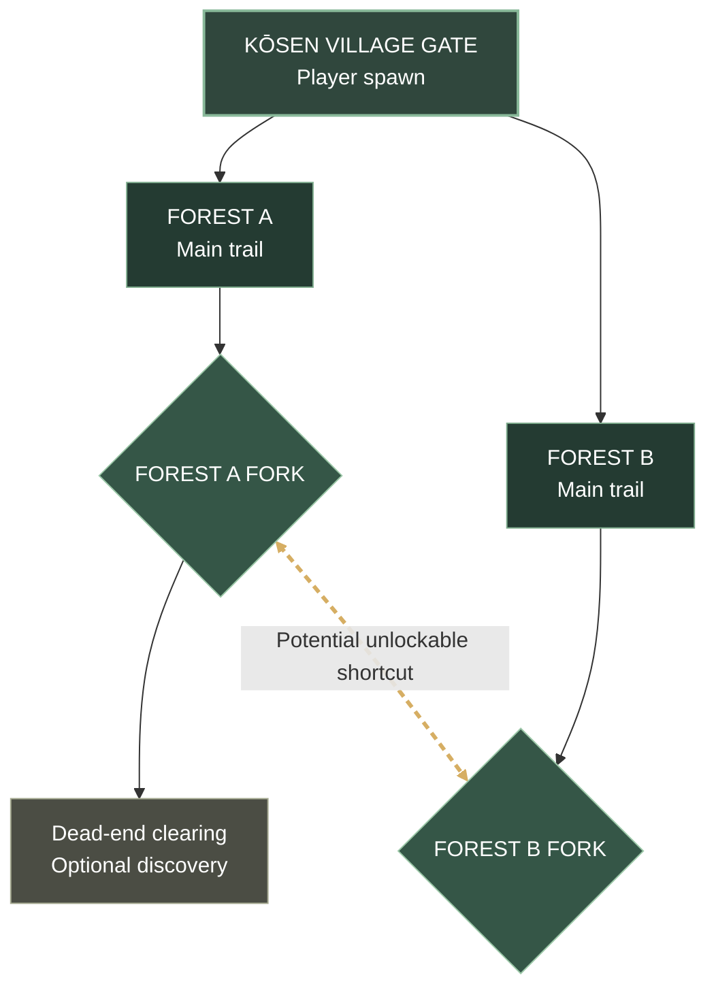

# Kōsen Forest — MVP World Map

**Status:** Approved starting layout · **Scope:** Kōsen Gate + Forest A + Forest B

## MVP route diagram

**Read order:** Spawn at Kōsen Gate → choose Forest A or Forest B → each trail leads to its own fork → Forest A's fork has a dead-end branch → the **potential shortcut connects Forest A's fork directly to Forest B's fork**. It does **not** connect back to the gate.

### MVP design notes
- One contiguous forest biome, two playable routes; branching exploration and backtracking.
- Basic bandit, heavy bandit, and one boss. Enemy placements and boss location remain TBD.
- Gold dashed line denotes a **proposed shortcut**, not a mandatory starting connection; its unlock condition is TBD.
- Forest C and the neighboring village gate are excluded from the MVP.
- This diagram is a **topology**, not a geographically scaled level map. Exact trail geometry and distances are TBD.

## Future revisions
Add checkpoint positions, encounters, landmark names, rewards, boss arena, and unlock conditions as they are decided. Keep this diagram simple enough to read on mobile.
