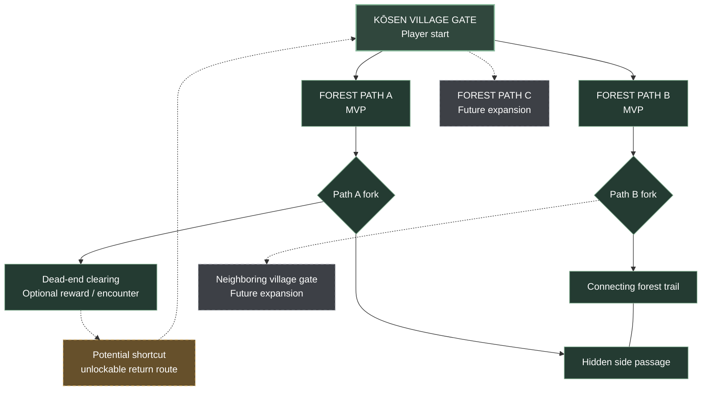

# Kōsen Forest — World Map Structure

**Version:** 0.1 · **Status:** evolving world topology · **MVP:** Kōsen home gate + two forest routes

This folder is the canonical, version-controlled location for world-map planning. GitHub renders the diagram below automatically, so we can review and revise the structure together without uploading a new screenshot each time.

## World structure — planned routes

### Reading the diagram
- **Solid connections:** established forest paths and the interconnecting branch between A and B.
- **Dashed gray connections:** planned expansion beyond the MVP, including Path C and the neighboring village gate.
- **Gold dashed shortcut:** **potential** unlockable return route from the dead-end clearing toward the Kōsen gate. This is a design proposal, not yet finalized in-world geography.

### MVP boundaries
- Implement Kōsen Village gate as the player spawn and starting landmark.
- Implement **two** connected forest routes (A and B), including their forks, with the inter-path connection as the first navigation test.
- Reserve the third forest route and neighboring village approach for later; block access in a natural, intentional way.
- Keep the basic bandit, heavy bandit, and one boss. Exact enemy placement, checkpoint positions, and boss arena are TBD.
- Preserve navigation via landmarks, discoverable detours, and backtracking.

### Revision workflow
1. Update this Mermaid graph when a path, fork, shortcut, checkpoint, or region is added.
2. Add a short note to **Revision history** below.
3. Do not silently turn proposed dashed connections into confirmed routes.
4. Keep future maps under `world/maps/` and link them from this index.

### Revision history
- **v0.1:** Kōsen gate start; three planned forest paths; two-path MVP; dead-end fork, inter-path connection, future neighboring village gate; proposed unlockable shortcut returning toward home gate.
